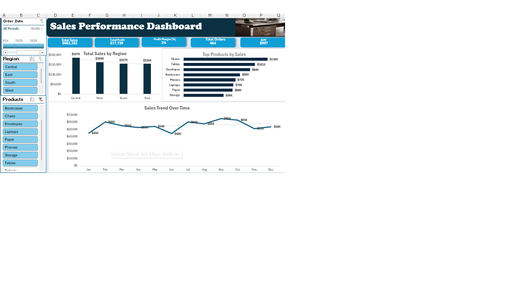

# Sales Performance Analysis | Excel Dashboard

## Project Overview

This project analyzes sales transaction data using Microsoft Excel to evaluate revenue, profitability, customer purchasing activity, and product performance.

An interactive Sales Performance Dashboard was developed to help business stakeholders monitor key performance indicators (KPIs), identify sales trends, and make data-driven decisions.

## Business Objectives

- Evaluate overall sales and profitability.
- Compare sales performance across geographic regions.
- Identify top-performing products.
- Analyze monthly sales trends.
- Build an interactive dashboard for business reporting.

## Tools and Technologies

- **Microsoft Excel:** Data analysis and dashboard development
- **PivotTables and PivotCharts:** Data summarization and visualization
- **Excel Slicers:** Interactive filtering by region and product
- **Timeline Filter:** Analysis by order date
- **KPI Reporting:** Performance monitoring

## Dataset

The project uses a sales dataset containing 900 records.

The workbook includes transaction-level sales data and supporting worksheets for KPI calculations and dashboard visualizations.

## Key Performance Indicators

| KPI | Value |
|---|---:|
| Total Sales | $220,177 |
| Total Profit | $5,605 |
| Profit Margin | 3% |
| Total Orders | 220 |
| Average Order Value | $1,001 |

*Values represent the unfiltered dashboard view and are rounded as displayed.*

## Dashboard Features
## Dashboard Preview

The interactive dashboard includes:

1. **Total Sales by Region:** Compares revenue performance across geographic regions.
2. **Top Products by Sales:** Identifies products generating the highest sales.
3. **Sales Trend Over Time:** Visualizes monthly revenue patterns.
4. **Interactive Filters:** Allows users to explore results by date, region, and product.
5. **KPI Cards:** Displays important business performance metrics.

## Key Findings

- The Central region generated approximately $61K in sales, the highest among the four regions.
- The East region generated approximately $57K in sales.
- The South and West regions generated approximately $53K and $49K, respectively.
- The overall profit margin was approximately 3%, indicating an opportunity to investigate costs, pricing, and product profitability.
- The dashboard enables users to compare performance across regions and products.

## Business Recommendations

- Investigate low-margin products and potential cost drivers.
- Review successful sales strategies in the highest-performing regions.
- Monitor monthly revenue fluctuations to support planning.
- Use product-level performance insights to inform inventory and promotional decisions.

## Project Deliverable

**Sales Performance Dashboard — Microsoft Excel Workbook**

The Excel workbook includes the interactive dashboard, KPI calculations, supporting charts, and underlying sales data.

## Skills Demonstrated

Excel Data Analysis | PivotTables | PivotCharts | Slicers | KPI Reporting | Dashboard Design | Business Intelligence | Data Visualization

## Project Purpose

This project demonstrates my ability to transform sales data into an interactive business dashboard that supports performance monitoring and data-driven decision-making.
